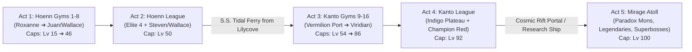

# GemTrio — True Native PC Port & Multi-Region Expansion
## Master Architecture & Implementation Plan

> **Target Platform:** Native Windows x64 Executable (`GemTrio.exe` via MinGW-w64 + SDL2 / OpenGL)  
> **Core Engine:** `pokeemerald-expansion` + `pokeemerald-multiplatform` native backend  
> **Asset Model:** *Ship of Harkinian* / *sm64pc* standalone legal extraction (zero copyrighted assets in repository)  
> **Save System:** Isolated host storage (`saves/gemtrio.sav`) with automated snapshot rotation (`saves/backups/`)  
> **Progression:** 5-Act Epic (Hoenn 1–8 → Hoenn E4 → Kanto 9–16 → Kanto E4 → Mirage Atoll Postgame)  
> **Extensibility:** Multi-region architecture architected for future regions (Johto, Sinnoh, Unova)

---

## 🏛️ Executive Architecture Overview

```mermaid
flowchart TD
    subgraph Legal Pipeline [Ship of Harkinian Legal Asset Pipeline]
        OfficialROM["Official ROMs (Emerald USA f3ae0881... / FireRed USA)"] --> Extractor["Asset Extractor (launcher/extractor.py)"]
        Extractor --> AssetPack["Host Asset Archive (assets/game_assets.bin)"]
    end

    subgraph Native Build [Native Desktop Compilation (Zero Emulation)]
        EngineSource["pokeemerald-expansion C Codebase (src/, include/, data/)"]
        SDL2Platform["Native Platform Layer (src/platform/ - SDL2, Audio, Windowing, D3D/GL)"]
        VFSModEngine["C Modding VFS (src/mod_loader/ - cJSON, Asset Overrides)"]
        EngineSource & SDL2Platform & VFSModEngine --> MinGW["Desktop GCC Compiler (x86_64-w64-mingw32-gcc)"]
        MinGW --> NativeExe["Standalone GemTrio.exe (64-bit Windows Executable)"]
    end

    AssetPack & NativeExe --> Runtime["Native PC Execution (60 FPS, Borderless Fullscreen, Controllers)"]
    Runtime <--> HostSaves["Dedicated Save Manager (saves/gemtrio.sav + saves/backups/)"]
    Runtime <--> ExternalMods["External Hot-Swappable Mods (mods/data/*.json, mods/sprites/*.png)"]
```

---

## 🗺️ Progression Roadmap (The 5 Acts)



---

## 📍 Act-by-Act Breakdown

### Act 1: The Hoenn Journey (Badges 1 – 8)
* **Starting Point:** Littleroot Town (standard Hoenn campaign).
* **Level Caps:**
  * 0 Badges: **Lv 10** (Early routes / Petalburg Woods)
  * Badge 1 (Roxanne – Stone): **Lv 15**
  * Badge 2 (Brawly – Knuckle): **Lv 19**
  * Badge 3 (Wattson – Dynamo): **Lv 24**
  * Badge 4 (Flannery – Heat): **Lv 29**
  * Badge 5 (Norman – Balance): **Lv 31**
  * Badge 6 (Winona – Feather): **Lv 33**
  * Badge 7 (Tate & Liza – Mind): **Lv 42**
  * Badge 8 (Juan / Wallace – Rain): **Lv 46**

### Act 2: The Hoenn Elite Four & Champion
* **Ever Grande City & Victory Road**: Level-scaled trainers leading up to the League.
* **Hoenn Elite Four**: Sidney, Phoebe, Glacia, Drake.
* **Hoenn Champion Battle**: Wallace (or Steven Stone).
* **Clearance Level Cap:** **Lv 50**.
* **Reward:** Unlocks S.S. Tidal inter-region maiden voyage pass to Kanto.

### Act 3: Kanto Reimagined (Badges 9 – 16)
Arriving from the sea at **Vermilion Port** creates an authentic regional journey that avoids backtracking across old routes:

| Badge # | City | Leader & Specialty | Level Cap | Narrative / Geographic Beat |
| :---: | :--- | :--- | :---: | :--- |
| **Badge 9** | **Vermilion City** | **Lt. Surge** (Electric) | **Lv 54** | **Landing Port**: Surge tests the Hoenn Champion right at the docks. |
| **Badge 10** | **Saffron City** | **Sabrina** (Psychic) | **Lv 58** | Travel North via Route 6; Central hub of Kanto with Silph Co. intrigue. |
| **Badge 11** | **Celadon City** | **Erika** (Grass) | **Lv 62** | West via Route 7; Department Store, Game Corner, and floral gardens. |
| **Badge 12** | **Fuchsia City** | **Koga / Janine** (Poison) | **Lv 67** | South down Cycling Road (Routes 16–18); Safari Zone & coastal gate. |
| **Badge 13** | **Cerulean City** | **Misty** (Water) | **Lv 72** | Northern expedition across waterways; Misty brings her fully tuned water team. |
| **Badge 14** | **Cinnabar Island** | **Blaine** (Fire) | **Lv 77** | Sea route past the seafoam channels; scorched volcanic battleground. |
| **Badge 15** | **Pewter City** | **Brock** (Rock) | **Lv 82** | Veteran Brock has hardened his roster with Gen 9 rock/ground powerhouses. |
| **Badge 16** | **Viridian City** | **Blue** (All-Around Finale) | **Lv 86** | The climatic final Gym battle in Kanto testing master team composition. |

### Act 4: The Kanto Elite Four & Champion Red
* **Kanto Victory Road**: Remapped with high-level trainers (Lv 80+).
* **Indigo Plateau**:
  * Elite Four Lorelei (Ice / Water, Lv 85–87)
  * Elite Four Bruno (Fighting / Steel, Lv 86–88)
  * Elite Four Agatha (Ghost / Poison, Lv 87–89)
  * Elite Four Lance (Dragon / Flying, Lv 88–90)
* **Kanto Champion Battle**: **Red** on the Indigo throne (Lv 90–92).
* **Milestone Level Cap:** **Lv 92**.
* **Reward:** Proven Dual-Champion title; Professor Oak and Steven confer to open the expedition to **Mirage Atoll**.

### Act 5: Mirage Atoll (Endgame / Postgame)
* **Location:** Uncharted coordinate in the deep sea between Hoenn and Kanto shrouded in cosmic space-time distortions.
* **Environment:** A multi-biome tropical coral atoll featuring crystalline shores, ancient ruins, and an inner volcanic caldera.
* **Wild Encounters:**
  * Top-tier Gen 8–9 species (Tinkaton, Dragapult, Palafin, Baxcalibur, Annihilape, Kingambit).
  * **Paradox Pokémon**: Roaring Moon, Flutter Mane, Iron Valiant, Iron Hands in rift zones.
* **Features:**
  * **Level Cap:** **Lv 100** (Full potential unlocked).
  * **Ancient Shrine Trials**: Catchable legendary encounters with modern battle themes.
  * **Battle Colosseum**: High-tier rematches against Hoenn and Kanto leaders with competitive Gen 9 EV/IV trained rosters.

---

## 🧩 Multi-Region Engine Architecture

To allow seamless addition of future regions (Johto, Sinnoh, etc.), the core engine decouples region logic from hardcoded constants:

### 1. Extensible Region Registry (`include/constants/region.h`)
```c
enum RegionId {
    REGION_HOENN,
    REGION_KANTO,
    REGION_MIRAGE_ATOLL,
    REGION_JOHTO,       // Future expansion
    REGION_SINNOH,      // Future expansion
    REGION_COUNT
};

struct RegionData {
    const u8* name;
    u16 badgeFlagsStart;
    u8 badgeCount;
    u16 flyDestinationDefault;
    u16 whiteoutRespawnMap;
};
```

### 2. Milestone-Based Progression Table (`src/caps.c` / `src/battle_setup.c`)
```c
// 22-step master progression table covering both regions and leagues
static const u8 sGemTrioProgressionCaps[22] = {
    10, // Early game (0 badges)
    // Hoenn Badges 1 - 8
    15, 19, 24, 29, 31, 33, 42, 46,
    50, // Hoenn Champion Defeated
    // Kanto Badges 9 - 16 (Vermilion -> Viridian)
    54, 58, 62, 67, 72, 77, 82, 86,
    92, // Kanto Champion Defeated
    100 // Mirage Atoll Cleared
};
```

---

## 💻 Native PC Platform Layer (Zero Emulation)

The native PC port uses the **`pokeemerald-multiplatform`** architecture. The GBA MMIO registers and BIOS calls are replaced by native host platform subsystems:

```
src/platform/
├── main.c              # WinMain / entrypoint, command-line parsing, SDL initialization
├── window.c            # SDL2 window management, aspect ratio, resizing, borderless F11
├── renderer_gl.c       # Hardware accelerated OpenGL / Direct3D texture blitter (60 FPS)
├── audio_sdl.c         # SDL2 Audio device streaming, native MP2K/M4A sound mixer
├── input_sdl.c         # Native gamepad support (XInput / DirectInput, Xbox, DualSense, Switch Pro)
├── storage.c           # Host file I/O: saves/gemtrio.sav and saves/backups/
└── asset_loader.c      # Virtual File System reading host assets and external /mods/
```

### Mod Support Engine (`src/mod_loader/`)
1. **`VFS_Init()`**: Initializes hash map of host `/mods/` directory on boot.
2. **`LoadAsset_Override()`**: Intercepts graphics/palette/sound loading calls. If a matching file exists in `/mods/sprites/` or `/mods/palettes/`, it serves the external file directly.
3. **`cJSON` Data Patching**: Reads `mods/data/*.json` on startup to overwrite base stats, encounter tables, and trainer rosters without recompiling.

---

## 🛡️ Legal Ship of Harkinian Asset Extraction Pipeline

To ensure the repository can be safely hosted on GitHub without any threat of Nintendo copyright strikes or DMCA takedowns:
1. **Zero Assets in Git**: No `.gba` ROMs, no Nintendo `.bin` BIOS dumps, and no extracted commercial assets are committed to version control.
2. **First-Run Extraction**:
   - The user launches `GemTrio.exe` (or `Play_GemTrio.bat`).
   - The launcher requests the user's authentic *Pokemon - Emerald Version (USA)* ROM (`f3ae0881...`) and *Pokemon - FireRed Version (USA)* ROM.
   - Built-in extractor script (`launcher/extractor.py` or compiled C# helper) reads tilemaps, sprites, and audio samples directly from the verified ROMs into local `assets/` on the user's PC.
   - Generates local `game_assets.bin` and marks setup as complete.

---

## 🗂️ Project Directory Blueprint

```
GemTrio/
├── GemTrio.exe                 # Standalone native 64-bit Windows PC game
├── Play_GemTrio.bat            # Quick launcher script
├── Makefile                    # Native desktop build configuration (MSYS2 / MinGW-w64)
├── assets/                     # Locally extracted game assets (ignored by git)
├── launcher/                   # Launcher source & ROM asset extractor
│   ├── Launcher.cs             # C# Windows GUI launcher
│   └── extractor.py            # ROM asset unpacking tool
├── saves/                      # Dedicated player save directory (ignored by git)
│   ├── gemtrio.sav             # Active battery save
│   ├── backups/                # Automated timestamped session snapshots
│   └── states/                 # Quick save states
├── mods/                       # External hot-swappable mod directory
│   ├── data/                   # JSON balance patches (base_stats.json, trainers.json)
│   ├── sprites/                # Custom replacement sprites (.png)
│   └── palettes/               # Custom replacement palettes
├── src/
│   ├── platform/               # Native PC platform layer (SDL2 window, audio, input, GL)
│   ├── mod_loader/             # VFS, cJSON, and runtime asset override engine
│   ├── battle_setup.c          # 22-step multi-region level cap enforcement
│   ├── caps.c                  # EV cap scaling across 16 badges and leagues
│   └── new_game.c              # QoL defaults and save initialization
├── data/
│   ├── maps/                   # Map layouts and scripts (Hoenn, Kanto, Mirage Atoll)
│   │   ├── *_Frlg/             # Integrated Kanto maps
│   │   └── MirageAtoll_*/      # New postgame island maps
│   └── scripts/
│       └── gemtrio.inc         # Inter-region ferry scripts & cap announcements
└── include/
    ├── config/                 # Modern mechanics toggles (battle, item, overworld)
    └── constants/              # Region enums, badge flags, and trainer constants
```

---

## 📋 Step-by-Step Execution Milestones

### Phase 1: Native Desktop Platform Layer (Zero Emulation)
- [ ] Pull in the `pokeemerald-multiplatform` SDL2 platform code into `src/platform/`.
- [ ] Replace GBA register writes with host OpenGL/Direct3D framebuffer blitting.
- [ ] Implement SDL audio streaming for native M4A/MP2K audio output.
- [ ] Configure `Makefile` for native host compilation via MinGW-w64 (`x86_64-w64-mingw32-gcc -lSDL2`).
- [ ] Verify standalone compilation directly produces `GemTrio.exe`.

### Phase 2: Modern Engine & Gen 9 Battle Mechanics
- [ ] Verify Gen 9 physical/special split, Fairy typing, and modern type effectiveness in `include/config/battle.h`.
- [ ] Confirm modern QoL: Reusable TMs, Gen 6+ Exp Share, and HM field move freedom (no moveslots required).
- [ ] Enable dynamic overworld palettes (DOWP), RTC day/night cycle, following Pokémon, and visible overworld encounters.
- [ ] Wire up nature stat color indicators and fast text defaults in `src/new_game.c`.

### Phase 3: Dual-Region Kanto Progression & Routing
- [ ] Enable FRLG layouts and tilesets in `tools/mapjson` for the GemTrio target build.
- [ ] Remap all 8 Kanto Gym scripts to use `FLAG_KANTO_BADGE01_GET` through `FLAG_KANTO_BADGE08_GET`.
- [ ] Implement custom Vermilion-first Gym progression order (Surge → Sabrina → Erika → Koga → Misty → Blaine → Brock → Blue).
- [ ] Add the S.S. Tidal inter-region ferry linking Lilycove/Slateport and Vermilion Port in `data/scripts/gemtrio.inc`.
- [ ] Wire up Kanto Elite Four (Indigo Plateau) and Champion Red battle scripts.

### Phase 4: Mirage Atoll (Postgame Expansion)
- [ ] Design map layouts for `MirageAtoll_Exterior`, `MirageAtoll_Ruins`, and `MirageAtoll_Colosseum`.
- [ ] Configure high-tier wild encounters featuring Gen 8–9 and Paradox Pokémon in `wild_encounter.json`.
- [ ] Script the postgame portal/ship expedition trigger after defeating Champion Red.
- [ ] Implement Lv 100 level cap unlock and endgame boss rematch gauntlets.

### Phase 5: Hot-Swappable PC Mod Engine & Save Security
- [ ] Hook `VFS_Init()` and `LoadAsset_Override()` into the native host asset pipeline.
- [ ] Implement `cJSON` data loader to apply `mods/data/*.json` patches on boot.
- [ ] Enforce save isolation to `saves/gemtrio.sav` with pre-session and post-session automated backups.
- [ ] Complete the *Ship of Harkinian* ROM asset extraction wizard in `launcher/`.

---

## 🎯 Verification & Acceptance Checklist

1. **Native Execution**: `GemTrio.exe` runs on Windows as a native 64-bit app with SDL2 hardware acceleration (60 FPS, borderless fullscreen via `F11`, zero emulation cores).
2. **Copyright Cleanliness**: The git repository contains zero `.gba` ROMs or proprietary `.bin` BIOS dumps; asset extraction runs exclusively on the user's PC.
3. **Save Security**: In-game saves are stored strictly in `saves/gemtrio.sav`, and timestamped snapshots appear in `saves/backups/`.
4. **Progression Check**:
   - Defeating Hoenn Gyms 1–8 caps party from Lv 15 to Lv 46.
   - Hoenn League clears at Lv 50 cap and unlocks S.S. Tidal to Vermilion Port.
   - Kanto Gyms follow custom Vermilion-first sequence up to Lv 86 cap.
   - Kanto League clears at Lv 92 cap against Champion Red.
   - Mirage Atoll unlocks with wild Gen 9/Paradox encounters and the Lv 100 final cap.
5. **Modding**: Dropping a valid JSON stat override into `mods/data/base_stats.json` alters in-game stats immediately upon launch without recompiling.
